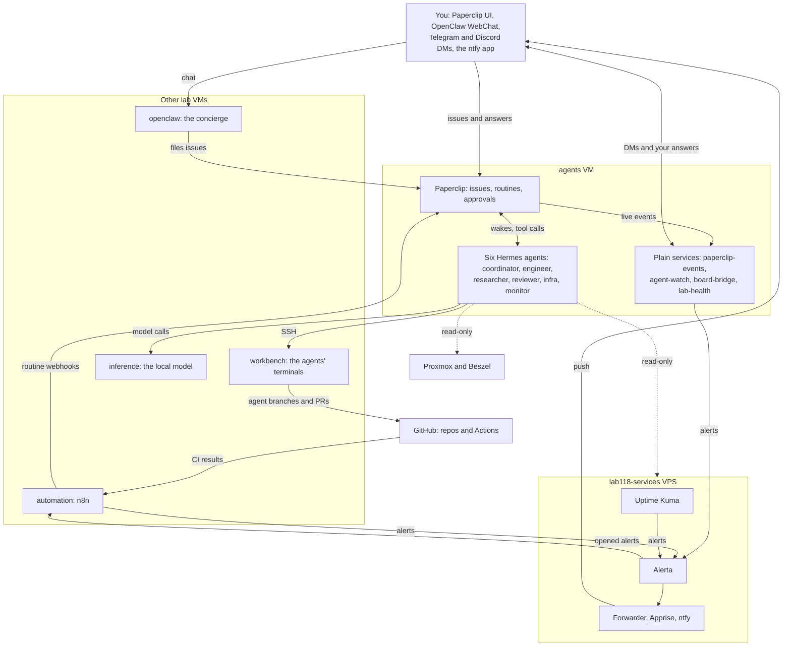
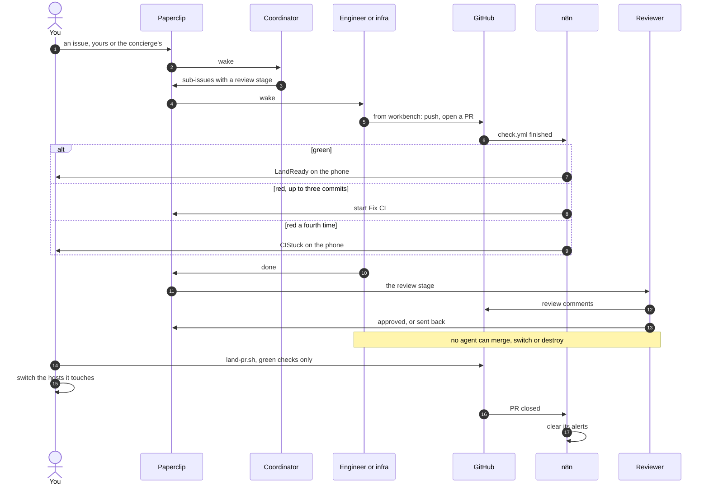
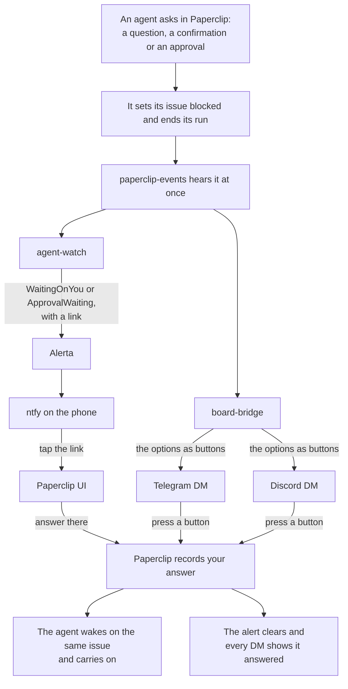
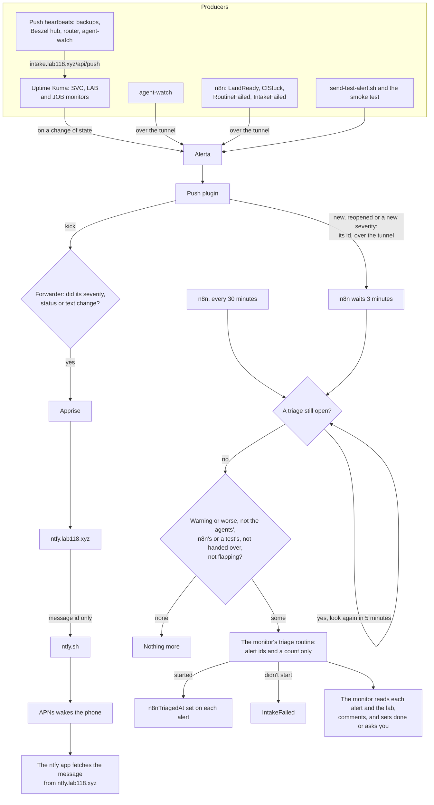
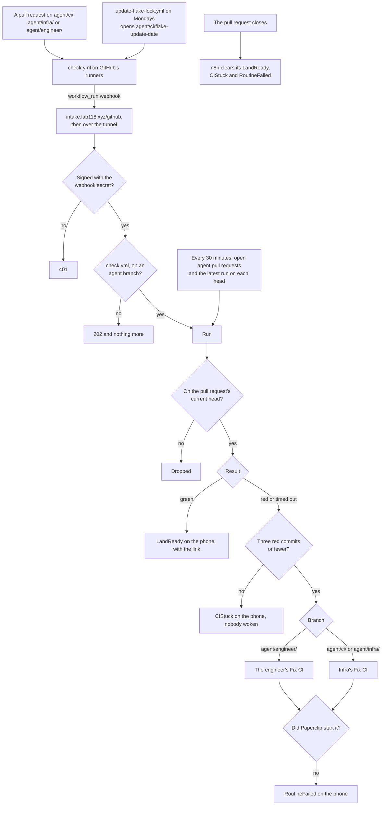
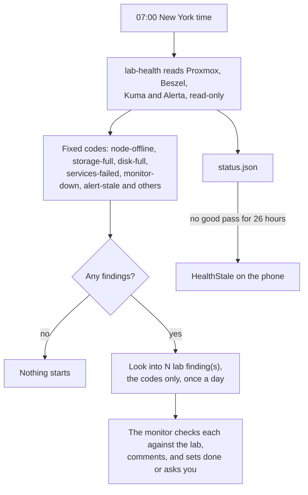
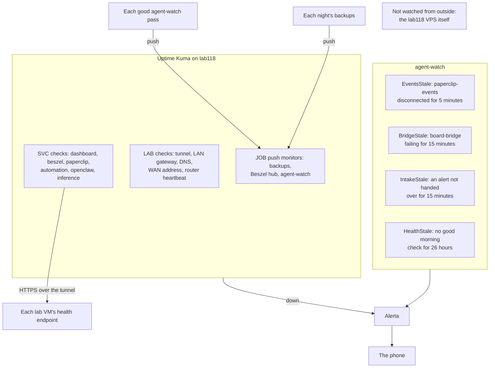

# How the agents and the alerts fit together

The agent platform and the notification stack are written up host by host in
each `docs/<host>/REFERENCE.md`. This page is the picture across all of them:
who starts what, what crosses between hosts, and where each thing ends up,
including your phone. The details, settings and limits stay in the reference
docs, which each section points to.

Two rules shape every diagram here. Work starts from an event or from you,
not from a model checking in on a timer, and plain code (n8n, agent-watch,
lab-health) does the routing so a model only runs where judgment helps. And
no agent changes a running system: they read, they open pull requests, and
they ask. You land, switch and destroy.

## The map

Everything at once, by where it runs. Solid arrows carry work or alerts,
dotted ones only read. The sections after this zoom into each path.

The lab reaches lab118-services only over the WireGuard tunnel
(`10.118.0.1/30`), and lab118 reaches back only to the HTTPS of a few VMs
(`docs/lab118-services/REFERENCE.md`). The agents' egress filter lets each
agent reach the internet and only the lab addresses it needs
(`docs/agents/REFERENCE.md`).

## From a request to a landed change

You, or the concierge on your behalf, file an issue. The coordinator splits
it and gives each piece to the agent for it, with the reviewer as a review
stage. Code is written on workbench and leaves as a pull request on an
`agent/` branch, which is the only kind of branch the agents' GitHub account
can push.

Each step's details: the coordinator and the review gate in
`docs/agents/REFERENCE.md`, workbench and `land-pr.sh` in
`docs/workbench/REFERENCE.md`, and n8n's routing in
`docs/automation/REFERENCE.md`.

## When an agent needs you

An agent never asks in a comment, which reaches nobody. It asks in Paperclip,
sets its issue blocked and ends its run. Within seconds you hear about it on
three channels, and an answer on any of them, or in Paperclip itself, wakes
the agent where it stopped.

board-bridge answers as the board only for the presses and replies of your
own two accounts, in a DM. Rejecting an approval doesn't wake its agent;
approving does. See `docs/agents/REFERENCE.md`, "Asking you" and "Telegram
and Discord".

## An alert's path

Everything that goes wrong in the lab ends up in Alerta on lab118-services.
From there, one path takes it to your phone and another hands it to the
monitor agent to look into. Alerta's push plugin starts both, so neither
waits on a timer.

The text of an alert never reaches ntfy.sh, only a message id, and no alert
text reaches Paperclip, only Alerta's ids. Kuma's own test notification and
alerts from the agents, n8n and the test script are kept from the monitor,
and agent-watch raises IntakeStale when an alert that should have gone
hasn't after 15 minutes. See `docs/lab118-services/REFERENCE.md`, Delivery,
and `docs/automation/REFERENCE.md`, "Alerts from Alerta".

## CI on an agent branch

GitHub runs `check.yml` on every pull request. n8n reads the result and
decides, with plain rules, whether you hear that it's ready or an agent is
woken to fix it. GitHub never retries a delivery that failed, so the same
rules also run as a sweep every 30 minutes.

Fix CI is keyed on the run and its attempt, so nothing that repeats a run's
routing starts a second issue. See `docs/automation/REFERENCE.md`, "GitHub
deliveries".

## The morning check

At 07:00 lab-health reads the lab in code, with fixed thresholds, and wakes
the monitor only when something is wrong, with codes rather than text. A
quiet morning runs no model at all.

The thresholds, the codes and `expectedOffline` are in
`docs/agents/REFERENCE.md`, under the routines.

## Who watches the watchers

Each piece that would fail quietly has something outside it that notices.
Kuma checks the hosts and expects heartbeats from the jobs. agent-watch
checks the agents host's own services by their status files, and the alert
intake by what's still waiting in Alerta.

agent-watch itself is watched by its own push monitor, so if it stops, Kuma
says so. Nothing outside watches the VPS that holds Kuma, Alerta and ntfy;
that's in the known limits of `docs/lab118-services/REFERENCE.md`.
